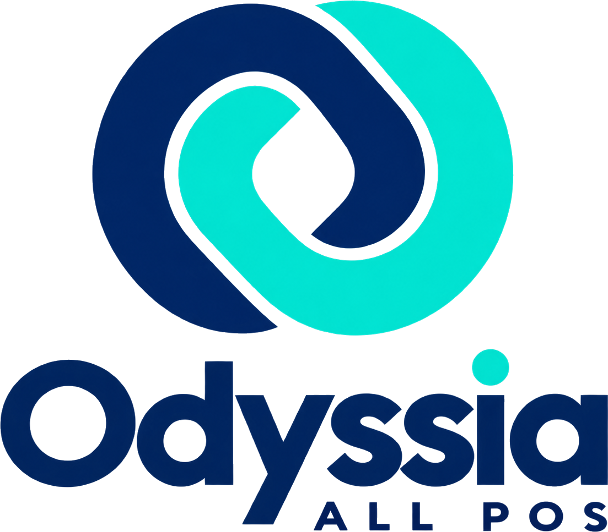

# Odyssia POS for Claude

A Claude plugin for **Odyssia ALL POS**, the point-of-sale and stock program by **Oudina Labs LLC** for shops, restaurants, pharmacies and offices (Windows and Android).

It lets Claude work with *your own shop*, on *your own computer*: read stock and sales, find mistakes in the catalogue, see debts and profit, and turn a dictated or photographed purchase invoice into a **draft that you approve inside Odyssia**. Nothing goes through Oudina Labs servers: the plugin talks only to the connector that runs inside Odyssia on the same computer (loopback address).

## What you need
- Odyssia POS on your computer, with **Settings > AI assistants** switched on. Copy the **port** (38765 by default) and the **access token** shown there.
- Node.js 18 or newer.
- Your own Claude account. The AI cost is yours; Oudina Labs does not provide or resell AI.

## Install in Claude Code
1. Set two environment variables once: `ODYSSIA_TOKEN` (the access token) and, if you changed it, `ODYSSIA_PORT`.
2. `/plugin marketplace add oudinalabs-rgb/odyssia-claude-plugin`
3. `/plugin install odyssia-pos@oudina-labs`
4. Restart, run `/mcp` and check that `odyssia` is connected.

Claude Desktop users can use the one-click extension instead: https://oudinalabs.com/odyssia/connectors

## What Claude can do
Read: products, low stock, business summary, debts, profit and loss, staff summary (no pay), catalogue health report. Write: only a purchase **draft** after you say yes; you approve it in Odyssia. Profit figures are management figures, not a tax statement.

## Privacy
The plugin runs a small bridge on your computer and sends nothing to us. What the assistant receives is what you let it read in the conversation, under the assistant provider's terms. Privacy policy: https://oudinalabs.com/odyssia/privacy.html

## About
**Oudina Labs LLC**, Sheridan, Wyoming 82801, United States. Website: https://oudinalabs.com/odyssia. Support: support@oudinalabs.com
